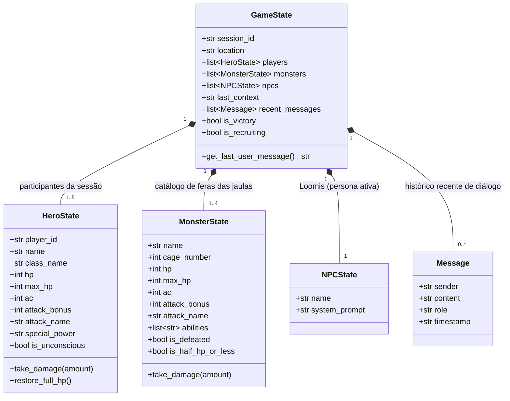
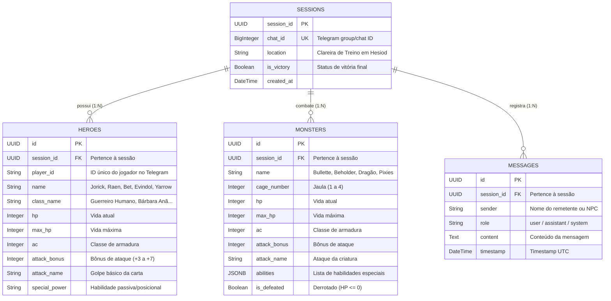
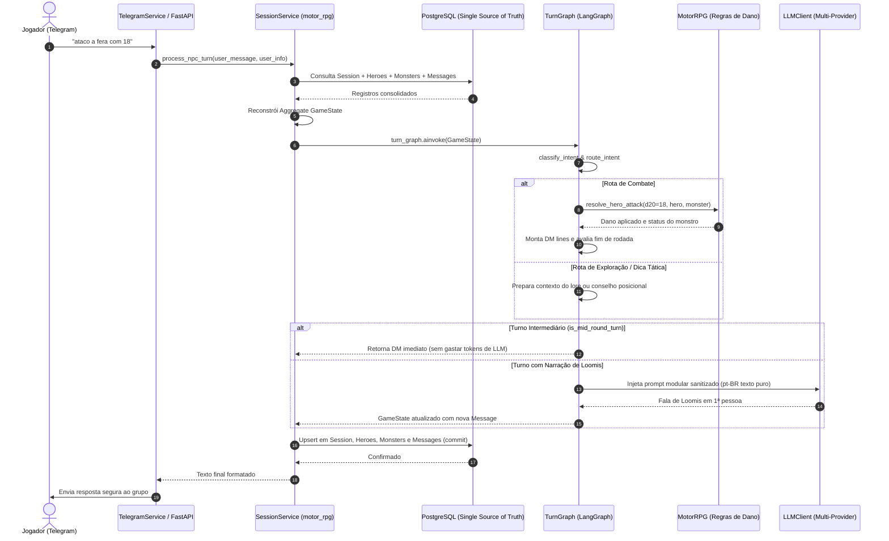
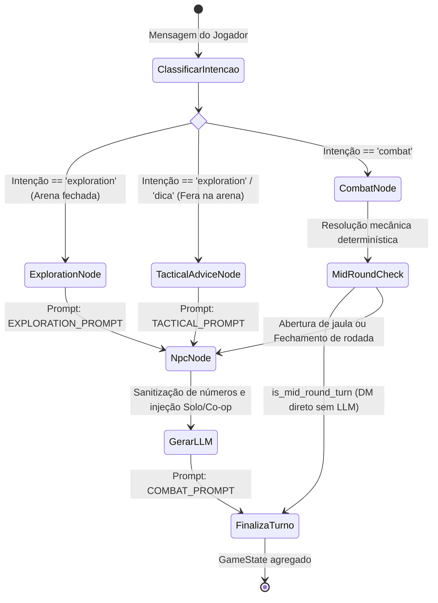
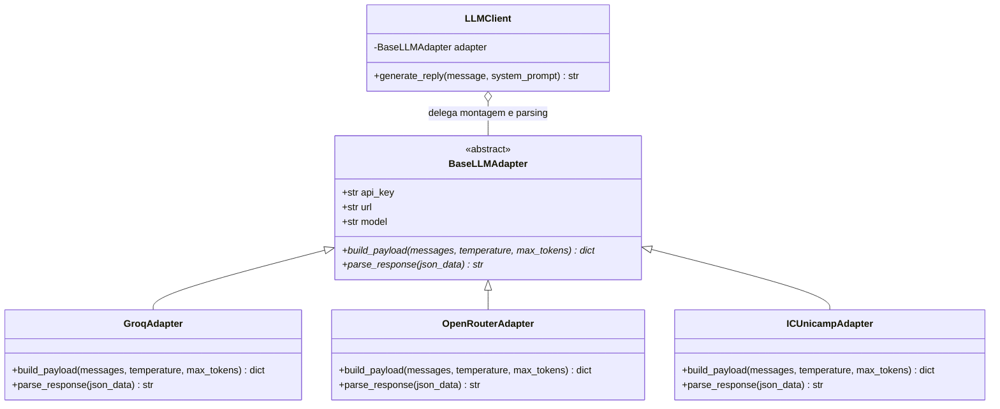

# Arquitetura do Sistema: AI-NPC (The Heroes of Hesiod)

Este documento detalha a arquitetura de ponta a ponta, a modelagem de domínio orientada a DDD (Domain-Driven Design), os princípios SOLID aplicados e o ciclo de vida dos fluxos do sistema de NPC Conversacional para Telegram e IA.

---

## 1. Visão Geral e Bounded Contexts (DDD)

O sistema é estruturado em Bounded Contexts com responsabilidades estritamente delimitadas:

```mermaid
flowchart LR
    subgraph BC_Telegram["Bounded Context: Ingress & Interface"]
        TelegramBot["Serviço do Telegram (telegram_bot/)"]
    end

    subgraph BC_MotorRPG["Bounded Context: Motor de Regras & Sessão (api/motor_rpg/)"]
        RulesEngine["Motor de Regras & Cálculos (d20 + bônus vs CA)"]
        SessionService["Serviço de Sessão & Persistência Relacional"]
    end

    subgraph BC_Cognitivo["Bounded Context: Cognição e Diálogo (api/ai_core/)"]
        TurnGraph["Grafo de Turno (LangGraph - 3 Rotas)"]
        LoomisNPC["Persona do Loomis (Prompts Modulares)"]
        LLMGateway["LLM Gateway Multi-Provedor (Groq / OpenRouter / IC)"]
    end

    subgraph BC_Persistencia["Bounded Context: Persistência Relacional (db/)"]
        PostgreSQL[("PostgreSQL: Single Source of Truth (sessions / heroes / monsters / messages)")]
    end

    subgraph BC_Observabilidade["Bounded Context: Telemetria & Observabilidade (Planejado)"]
        Langfuse[("Langfuse Tracing (Integração Futura)")]
    end

    TelegramBot -->|Mensagem / Ação do Usuário| SessionService
    SessionService -->|Carrega GameState do Banco| PostgreSQL
    SessionService -->|Dispara Turno com GameState Agregado| TurnGraph
    TurnGraph -->|Consulta Validações de Combate| RulesEngine
    TurnGraph -->|Injeta Prompt Modular & Contexto Sanitizado| LoomisNPC
    LoomisNPC -->|Gera Resposta em 1ª Pessoa| LLMGateway
    LLMGateway -.->|Tracing e Métricas (Futuro)| Langfuse
    TurnGraph -->|Retorna GameState Atualizado| SessionService
    SessionService -->|Persiste GameState Consolidado| PostgreSQL
    SessionService -->|Retorna Resposta Formatada ao Ingress| TelegramBot
```

### Definição dos Contextos Delimitados:
1. **Contexto de Interface (Telegram):** Recebe webhooks ou eventos de polling, mapeia remetentes (`chat_id`, `telegram_id`), garante sanitização contra HTML malformado (`_safe_reply`) e despacha mensagens formatadas ao grupo.
2. **Contexto do Motor RPG & Sessão:** Árbitro determinístico das regras oficiais de Hesiod (dados físicos, armaduras, vida, habilidades de cartas e gatilhos de jaula) e orquestrador de ciclo de vida com o PostgreSQL como fonte única da verdade.
3. **Contexto Cognitivo (Domínio de IA):** Modela a cognição e pedagogia do Treinador Loomis via LangGraph com 3 rotas especializadas (`exploration`, `tactical_advice`, `combat`) e prompts modulares isolados.
4. **Contexto de Gateway de IA (`llm_gateway`):** Implementa Strategy + Adapter Pattern com suporte plugável a provedores (Groq, OpenRouter, IC-Unicamp) via variável `LLM_PROVIDER`.
5. **Contexto de Observabilidade (Langfuse - Planejado):** Mapeado para monitoramento de latência e custos de tokens em produção futura (atualmente desacoplado do runtime principal para zero dependências externas bloqueantes).
6. **Contexto de Persistência Relacional:** Armazenamento relacional normalizado no PostgreSQL (`sessions`, `heroes`, `monsters`, `messages`).

---

## 2. Modelagem de Domínio (Domain Model & SOLID)

Seguindo DDD e o princípio da responsabilidade única (SRP), o modelo distingue o **Aggregate Root (`GameState`)** e suas **Entidades filhas ricas e auto-contidas**:



### Responsabilidades dos Elementos de Domínio:
* **`GameState` (Aggregate Root):** O estado consolidado da partida. Não rotaciona listas destrutivamente: a ordem dos jogadores é canônica e o controle de ações na rodada é feito por verificação de integridade (`_acted_heroes`).
* **`HeroState` e `MonsterState` (Entidades Ricas):** Encapsulam mutações de vida, armaduras e condições táticas (`take_damage`, `is_unconscious`, `is_half_hp_or_less`).
* **`last_context`:** Campo de comunicação inter-nós que armazena a resolução mecânica do Dungeon Master formatada para o jogador e posteriormente sanitizada para a IA.
* **`recent_messages`:** Histórico de conversação gravado de forma cronológica no banco com timestamps UTC, preservando as falas do usuário e as respostas do assistente.

---

## 2.1. Modelo Físico de Banco de Dados (PostgreSQL Relacional Normalizado)

O banco de dados reflete diretamente as entidades do domínio, com integridade referencial por chaves estrangeiras:



---

## 3. Dinâmica de Persistência: PostgreSQL como Single Source of Truth

Ao contrário de abordagens com cache volátil em RAM como fonte primária, o PostgreSQL é a **fonte única da verdade** de ponta a ponta:



---

## 4. Dinâmica de Jogo: Regras de Hesiod Adaptadas

### 4.1. Recrutamento e Prólogo de Exploração
1. **Alistamento (`/select <1-5>`):** Cada jogador alista um herói exclusivo. As fichas são compactadas no chat com poderes e ataques canônicos.
2. **Conclusão (`/done`):** Finaliza a fase de recrutamento e libera o **Modo de Exploração**.
3. **Exploração Livre:** Os heróis podem interagir com Loomis, investigar a cabana, o caldeirão de menta e limão e as jaulas trancadas. Loomis responde dúvidas de forma acolhedora e natural (sem repetir bordões de prontidão a cada fala).
4. **Abertura do Combate:** Disparada voluntariamente quando o grupo diz `"estamos prontos"` (ou forçada por impaciência de Loomis após 7 mensagens de conversa).

### 4.2. Dinâmica de Rodada e Combate Justo
* **Iniciativa da Equipe:** Os heróis agem um a um na ordem de alistamento. Cada herói rola seu d20 físico real e declara a ação.
* **Validação Rígida de Dados:** Mensagens com d20 inválido fora de 1 a 20 (`ataco com 50`) recebem aviso determinístico imediato do DM sem avançar o turno e sem chamar a IA.
* **Contra-ataque das Feras:** Ocorre no **fechamento da rodada** (quando o último herói consciente age). Monstros vivos atacam os heróis, priorizando quem tem mais vida e alternando alvos.
* **Gatilho de 50% de HP (Entrada Justa):** Se o monstro cair para $\le 50\%$ HP e estiver sozinho, a jaula seguinte é destrancada. A nova criatura entra na arena e ruge, mas **só contra-ataca na rodada seguinte**, evitando ataques duplos instantâneos contra jogadores solo.
* **Intervenção com Poção (Zero Frustração):** Quando heróis caem a 0 HP, Loomis arremessa sua poção revigorante, consolidado em um aviso único:
  `• [Hero] caiu inconsciente e Loomis o reanimou!`

---

## 5. Ciclo Cognitivo no LangGraph (`turn_graph.py`)

O pipeline cognitivo desacopla roteamento, regras mecânicas e narração da persona:



### Detalhamento dos Nós do Grafo:
* **`route_intent`:** Avalia a intenção via LLM (com fallback regex) e direciona para as 3 rotas:
  1. `exploration_node`: Roleplay na clareira pré-luta.
  2. `tactical_advice_node`: Dicas posicionais das cartas de herói em combate (ação livre que não gasta turno).
  3. `combat_node`: Resolução de d20 físico, dano a monstros e contra-ataques.
* **`is_mid_round_turn` (Economia e Velocidade):** Interrompe o grafo antes da LLM caso seja turno intermediário de iniciativa, aviso de d20 inválido ou herói inconsciente, retornando o feedback do DM imediatamente.
* **`npc_node` (Persona de Loomis):**
  * Recebe prompts modulares e independentes ([`prompts.py`](file:///home/isaac/Documents/mc030/ai-npc/api/ai_core/prompts.py)).
  * Filtra metagame via `_format_combat_context_for_llm` (remove números de HP e danos brutos).
  * Injeta diretivas contextuais estritas:
    * **Abertura de Jaula:** Ordena o primeiro golpe sem inventar ataques passados.
    * **Modo Solo vs Co-op:** Trata o herói individualmente pelo nome sem alucinar "equipe".
    * **Sanitização:** Remove tags HTML e pontuação estrangeira para garantir texto puro em pt-BR.

---

## 6. Gateway Multi-Provedor LLM (`llm_gateway`)

O subsistema de IA utiliza o padrão **Strategy + Factory** para desacoplar a aplicação dos provedores:



* **`GroqAdapter` (Padrão):** Suporta modelos de raciocínio com margem dinâmica de tokens para *thinking tags*.
* **`OpenRouterAdapter`:** Fallback para modelos livres (como Nemotron).
* **`ICUnicampAdapter`:** Conector para infraestrutura acadêmica local da Unicamp.
* **Seleção Transparente:** Controlada via `LLM_PROVIDER=groq|openrouter|ic` no `.env`.

