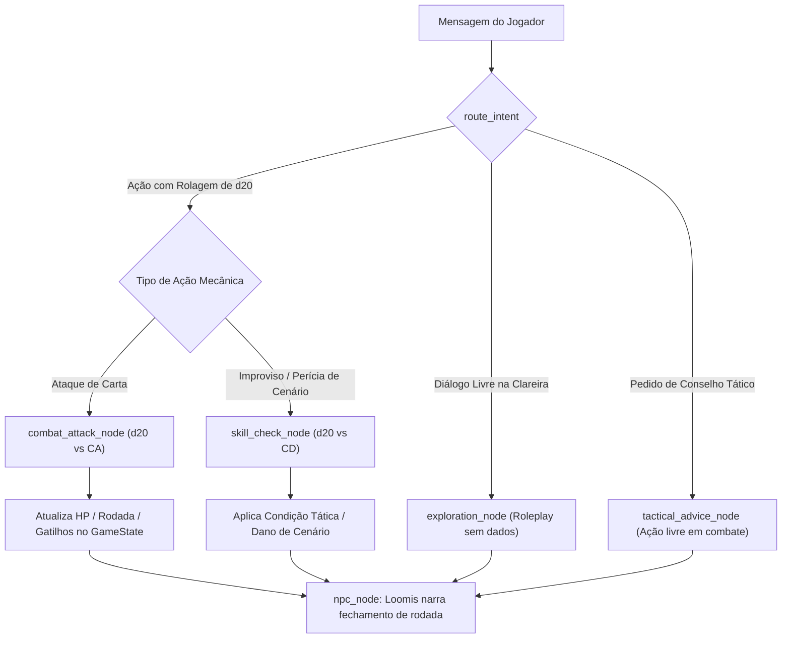

# Proposta de Melhorias: Motor de Perícias & Roleplay Avançado (D&D Style)

Este documento detalha o desenho técnico e a modelagem conceitual para elevar o nível de roleplay do projeto **AI-NPC (The Heroes of Hesiod)**, viabilizando **ações livres de cenário e testes dinâmicos de perícia (*Skill Checks*)** sem inchar a arquitetura, sem criar nós redundantes e sem desvirtuar a identidade do **Treinador Loomis**.

---

## 1. Por que NÃO substituir o Nó de Exploração?

O nó de exploração (`exploration_node`) cumpre um papel indispensável: **permitir diálogo puro e imersão sem a barreira mecânica do dado**.
* O jogador deve poder perguntar quem capturou as feras, pedir detalhes da vila ou conversar sobre a cabana sem ser forçado a rolar testes o tempo todo.
* Diálogo puro e roleplay conversacional continuam pertencendo à rota de exploração.

---

## 2. Unificação Arquitetural: O d20 como Árbitro Único de Ação

A chave para não criar nós redundantes é reconhecer a equivalência matemática fundamental do D&D:
* **Ataque com Carta:** `d20 + bônus de ataque vs. CA (Classe de Armadura do Monstro)`.
* **Teste de Perícia:** `d20 + modificador de atributo vs. CD (Classe de Dificuldade da Ação)`.

Ambos são **resoluções de ação mecânica com d20**. Em vez de criar um nó paralelo solto, a rota de resolução de dados (`action_node`) se especializa em dois sub-fluxos:



---

## 3. Como Funciona o Sub-Fluxo de Perícia (`skill_check_node`)

### 3.1. Identificação de Perícia e CD pela IA
Quando o jogador tenta uma manobra de cenário (ex: *"empurro o caldeirão de menta e limão no Bullette"*, *"tento sabotar as trancas da jaula"*):
1. A IA extrai a intenção mecânica e atribui:
   * **Perícia / Atributo:** Atletismo, Furtividade, Persuasão, Arcanismo, etc.
   * **Classe de Dificuldade (CD):** CD 10 (Fácil), CD 15 (Média), CD 20 (Difícil).
2. O Dungeon Master (sistema) cobra a rolagem física:
   > *"Dungeon Master: Para tentar virar o pesado caldeirão de ferro sobre o monstro, declare sua ação e role um teste de **Atletismo (CD 12)** com seu d20 físico!"*

### 3.2. Mapeamento de Atributos e Perícias dos Heróis
Os 5 heróis canônicos recebem seus modificadores temáticos para testes fora de combate:

| Herói | Classe | Atributo Principal | Perícias Notáveis | Modificador |
| :--- | :--- | :--- | :--- | :---: |
| **Jorick** | Guerreiro | Força (+3) | Atletismo, Intimidação | +5 / +2 |
| **Raen** | Bárbara | Força (+4) | Atletismo, Sobrevivência | +6 / +2 |
| **Evindol** | Ladino | Destreza (+4) | Furtividade, Prestidigitação | +6 / +6 |
| **Bet** | Maga | Inteligência (+4) | Arcanismo, Investigação | +6 / +4 |
| **Yarrow** | Xamã | Sabedoria (+3) | Percepção, Natureza | +5 / +4 |

### 3.3. Resolução Determinística no Motor RPG (`motor_rpg.py`)
```python
def resolve_skill_check(hero: HeroState, skill: str, dc: int, d20: int) -> dict[str, Any]:
    mod = hero.get_skill_mod(skill)
    total = d20 + mod
    success = total >= dc
    return {
        "hero_name": hero.name,
        "skill": skill,
        "d20": d20,
        "modifier": mod,
        "total": total,
        "dc": dc,
        "success": success,
        "is_critical": (d20 == 20),
    }
```

---

## 4. Exemplos Práticos de Interação

### Cenário 1: Sabotagem de Jaula
* **Jogador (Evindol):** *"Vou tentar destrancar a Jaula 2 na surdina para a criatura fugir pela vila."*
* **DM:** *"Evindol, role um teste de **Furtividade (CD 18)** contra a vigilância de Loomis!"*
* **Falha (d20 = 8 + 6 = 14):**
  * **Efeito:** A tranca faz barulho alto e emperra.
  * **Loomis:** *"Tire as patas dessa alavanca, Evindol! Acha que sou cego? Se quer enfrentar a fera, faça de peito aberto na arena, não pelas costas da vila!"*

### Cenário 2: Ação de Cenário em Combate
* **Jogador (Raen):** *"Quero chutar o caldeirão de menta e limão fervendo em cima do Bullette!"*
* **DM:** *"Raen, role um teste de **Atletismo (CD 12)** para virar o caldeirão!"*
* **Sucesso (d20 = 14 + 6 = 20):**
  * **Efeito:** O monstro sofre 2 de dano de fogo e perde a próxima ação atordoado.
  * **Loomis:** *"Minha melhor poção de treino! Mas que belo chute, bárbara! A fera está desnorteada, aproveitem a brecha!"*

---

## 5. Diretriz de Design: Conversational-First e Teatro da Mente

Na evolução de sistemas de RPG conversacional com agentes inteligentes, a definição da **interface e dinâmica da conversa deve preceder e orientar a modelagem das regras mecânicas**:

### 5.1. Adequação de Mídia: Grid de Tabuleiro vs. Chat Textual
* O material de referência original (*The Heroes of Hesiod*) foi concebido para mesa de RPG física, baseando-se em grid quadriculado e posicionamento relativo de miniaturas.
* Na transposição para um canal assíncrono e conversacional (Telegram), regras focadas em coordenadas ou métricas de distância física (como empurrão de casas ou flanqueamento geométrico) geram ruído para o usuário final e exigem inferências espaciais frágeis dos modelos de linguagem.
* **Paradigma do Teatro da Mente (*Theater of the Mind*):** A experiência em chat privilegia ritmo, impacto descritivo e fluidez narrativa, substituindo a contagem de casas pela clareza de intenção das ações dos heróis.

### 5.2. Metodologia Conversational-First
* Em agentes LLM, **o fluxo de mensagens do usuário deve ser o ponto de partida do design**, derivando a complexidade do grafo e do modelo de dados apenas a partir de interações testadas e validadas:
  1. **Validação Prévia do Diálogo:** Prototipar interações completas de ponta a ponta para identificar o que o jogador realmente precisa ver e digitar.
  2. **Carga Cognitiva Reduzida:** Fichas de heróis e notificações do sistema devem priorizar síntese e legibilidade no mensageiro.
  3. **Mecânica a Serviço da Conversa:** Novas regras mecânicas (como o subsistema de perícias e testes livres de cenário) devem ser integradas de forma transparente, sem fragmentar o fluxo natural de bate-papo.

---

## 6. Resumo das Vantagens Arquiteturais

1. **Design Conversacional Enxuto:** Interface limpa no Telegram, cartas objetivas e foco no roleplay em primeira pessoa do NPC Loomis.
2. **Sem Redundância no Grafo:** Não duplica nem descarta o `exploration_node` (conversa pura continua fluindo livremente).
3. **Coerência com o Domínio:** Trata ataques e perícias como especializações de uma mesma coisa: resoluções determinísticas de d20.
4. **Preservação de Papéis:** O DM continua sendo o juiz matemático e Loomis o NPC carismático reagindo aos sucessos e fracassos dos alunos.
