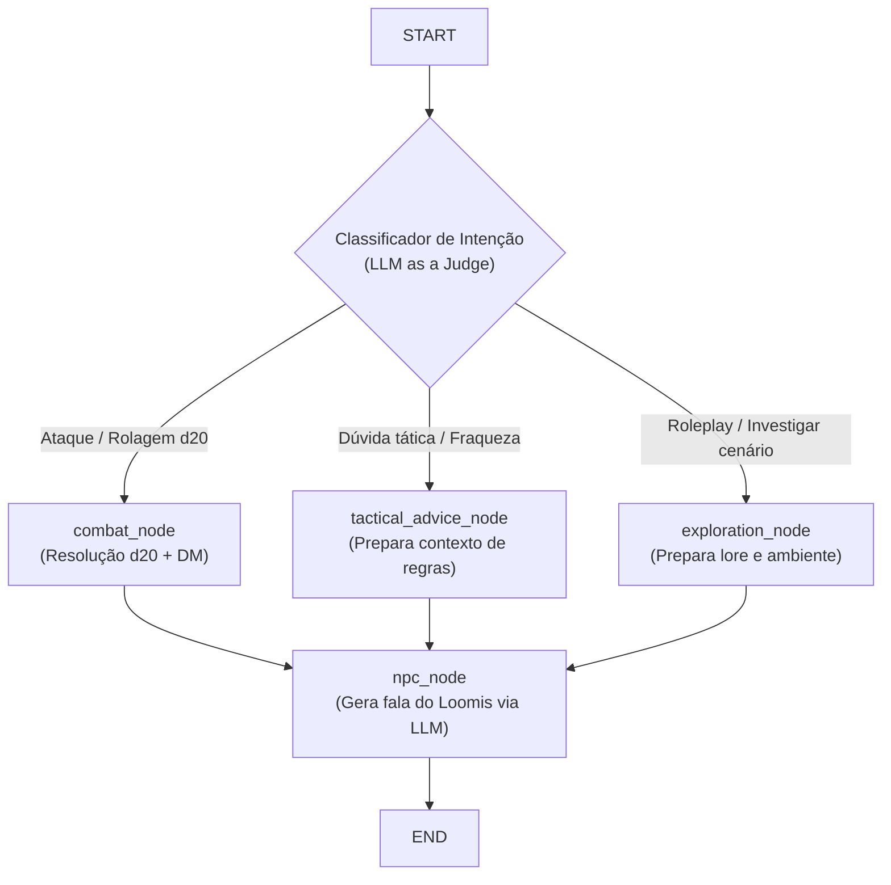

# Roadmap de Implementação: Modo Exploration & Refinamento de Gameplay (next_steps.md)

Este documento estabelece o plano de ação para **outubro**, com foco em **features de negócio, roleplay e jogabilidade**, pausando a integração de Langfuse e Nvidia Guardrails. Enquanto o Murillo (E2) assume os guardrails determinísticos por regex e infraestrutura, este roadmap detalha a correção de débitos arquiteturais (fixes preliminares) e a criação do **Modo Exploration**.

---

## 0. Fixes Preliminares (Débitos Arquiteturais & Estado 1:1 com o Banco)

Antes de implementar as novas features de exploração, devemos sanar débitos técnicos que violam a fidelidade do modelo ao banco de dados:

### Fix 1: Remover `round_actions` do `GameState` (Modelo 1:1 com PostgreSQL)
* **Problema:** `round_actions` foi inserido no schema Pydantic `GameState`, mas não existe na tabela `sessions` do PostgreSQL, quebrando a paridade 1:1 com o banco relacional.
* **Solução:**
  * Remover o campo `round_actions` de [`api/schemas/rpg.py`](file:///home/isaac/Documents/mc030/ai-npc/api/schemas/rpg.py).
  * Isolar o buffer de ações da rodada em um estado temporário de execução ou em um gerenciador de rodada dedicado, mantendo o `GameState` estritamente fiel ao schema do banco.

### Fix 2: Eliminar o Anti-Pattern de Cache Global (`_MEMORY_SESSIONS`)
* **Problema:** O dicionário global em memória (`_MEMORY_SESSIONS` em `session_service.py`) gera inconsistência entre instâncias, mascara acessos ao banco e pode reter estados defasados.
* **Solução:**
  * Tratar o **PostgreSQL como a fonte única da verdade (Single Source of Truth)**.
  * Carregar e persistir o `GameState` diretamente via transações do SQLAlchemy, eliminando a dependência de dicionários globais estáticos em processo.

### Fix 3: Memória de Curto Prazo Seletiva (Histórico Focado em Exploração)
* **Diagnóstico:** Passar histórico longo de mensagens durante o **Combate** é desperdício de tokens e aumenta o risco de alucinação (no combate, o modelo só precisa saber o que rolou no round atual via bloco mecânico do Dungeon Master).
* **Solução:**
  * **Em `combat`:** O LLM recebe apenas o resumo determinístico do round atual (`last_context`) e a última ação.
  * **Em `tactical_advice`:** Foco na dúvida pontual sobre o monstro e a classe ativa.
  * **Em `exploration`:** **Aqui sim** injeta o histórico recente de mensagens (`recent_messages`), pois no roleplay conversacional o modelo precisa acompanhar o diálogo (ex.: *"E o que tem dentro dela?"* referenciando a cabana citada na mensagem anterior).

### Fix 4: Remover Fallback de Prompt Hardcoded no Código (`FALLBACK_LOOMIS_PROMPT`)
* **Problema:** Manter strings de prompt estáticas no código Python gera redundância e mascara a leitura real do banco. Como o jogo depende 100% do PostgreSQL para persistir sessões e mensagens, o fallback de código é ilusório (se o banco cair, o jogo já não funciona).
* **Solução:**
  * Remover o `FALLBACK_LOOMIS_PROMPT` de [`api/ai_core/turn_graph.py`](file:///home/isaac/Documents/mc030/ai-npc/api/ai_core/turn_graph.py).
  * O prompt deve ser recuperado estritamente da tabela `npcs` via SQLAlchemy.
  * O lore de Hesiod e as instruções do modo de exploração residirão **diretamente no `system_prompt` do NPC Loomis na tabela `npcs`**, sem necessidade de criar tabelas extras dedicadas a lore.

### Fix 5: Identificação Correta do Herói por Jogador e Alvo do Monstro (Bug de HP Unilateral)
* **Problema (Mesmo após o commit `d4cee24`):** O jogo continuava atribuindo ataques e focando o contra-ataque sempre no mesmo herói por duas causas raízes:
  1. **Falta de persistência da ordem de iniciativa:** O `state.rotate_players()` só girava a fila em memória RAM. Ao recarregar a sessão do banco de dados a cada mensagem (`db.query(HeroDB)`), o primeiro da lista (`state.players[0]`) sempre resetava para o mesmo registro.
  2. **Ignorava o remetente real do Telegram:** O `combat_node` assumia que o atacante era o `state.players[0]`, sem checar quem de fato enviou a mensagem (`user_id` / `telegram_id` em `user_info`). Se o jogador com a Raen falasse fora da ordem imaginada, o golpe ainda saía no nome do Jorick.
  3. **Foco viciado do Monstro:** O monstro atacava apenas usando `max(hp)`, batendo repetidamente no herói com mais vida inicial (ex.: Raen com 7 HP) até a vida dele cair, violando a regra canônica de *"evitar focar na mesma vítima duas vezes seguidas"*.
* **Solução:**
  * No `turn_graph.py` e `orchestrator.py`, identificar o herói que está agindo comparando o remetente da mensagem (`user_info.get("telegram_id")` ou `player_id`) com os registros de `state.players`.
  * Garantir que o ataque seja debitado no histórico em nome do personagem do jogador real.
  * No contra-ataque da criatura, implementar a regra canônica: priorizar maior HP, mas **excluir o alvo atingido no turno anterior** se houver outro herói consciente na arena.

---

## 1. Visão Geral: Os Três Modos de Jogo

| Modo | Objetivo | Mecânica / Regras | Comportamento do Sistema |
| :--- | :--- | :--- | :--- |
| **`exploration`** *(Novo)* | Roleplaying livre, imersão no lore de Hesiod, investigação de pistas e diálogo com Loomis. | **Livre / Sem iniciativa:** Não exige d20, não desconta HP, não rotaciona a fila de jogadores. | **Narrador / Loomis (Roleplay):** Descreve ambiente sensorial e responde como mentor experiente. |
| **`tactical_advice`** | Orientação tática e esclarecimento de poderes especiais durante a preparação ou luta. | **Ação Livre:** Perguntas sobre pontos fracos da fera atual ou como aplicar regras posicionais. | **Loomis (Tutor):** Enérgico e direto, incentivando a próxima jogada sem gastar o turno. |
| **`combat`** | Resolução mecânica estrita de confronto contra as feras das 4 jaulas. | **Turno Rígido com d20:** Exige rolagem física de dado, cálculo determinístico de CA, dano e contra-ataque. | **Dungeon Master (HUD)** + **Loomis:** Bloco mecânico inquestionável + fala de reação em 1ª pessoa. |

> [!NOTE]
> **Sem alteração no GameState do Banco:** O modo de jogo não exige novas colunas ou migrações relacionais no banco de dados. A alternância é governada por **classificação por mensagem ("LLM as a judge")** e pelo contexto da sessão (ex: se há monstros ativos na arena).

---

## 2. Dinâmica de Onboarding e Transições

### 2.1. Novo Fluxo de Onboarding (Prólogo na Cabana & Dupla Voz)
1. **Seleção de Heróis:** Jogadores continuam escolhendo suas cartas canônicas (`/select 1-5`).
2. **Finalização do Recrutamento (`/done`):**
   * **Mudança-chave:** A Jaula 1 **NÃO** se abre imediatamente.
   * O sistema retorna uma mensagem combinada apresentando o cenário e convocando a ação:
     * **📜 Bloco do Dungeon Master (Ambientação):**
       > *O sol corta a floresta densa na clareira isolada atrás da cabana de treino. Quatro pesadas jaulas de ferro reforçado repousam sob as árvores, e um som abafado de garras arranhando a pedra ecoa pela mata. À frente de vocês, o lendário treinador Loomis cruza os braços fortes e fita os novos recrutas de Hesiod.*
     * **🗣️ Bloco de Loomis (Acolhimento & Chamado):**
       > *"Aí estão vocês! Escolheram bem as armas. Três meses de suor nesta vila levaram a este dia. Olhem ao redor e conversem comigo se quiserem, mas não se acomodem: quando estiverem prontos para a primeira fera, me digam 'estamos prontos' para eu puxar a alavanca!"*

### 2.2. Transição Orgânica para o Combate & Retorno ao Foco por Contagem
Para evitar que os jogadores fiquem conversando indefinidamente e se percam do objetivo, o `exploration_node` monitora o **número de mensagens de exploração** trocadas:

1. **Mensagens 1 a 3 (Exploração Acolhedora):**
   * Loomis responde com paciência, tira dúvidas sobre o passado da vila, a cabana e o caldeirão de poções de menta e limão.
2. **Mensagens 4 a 6 (Gatilho de Impaciência de Loomis):**
   * Como treinador de sangue de ogro, Loomis começa a perder a paciência. O nó injeta no contexto instrução para que ele corte papo furado e pressione:
     > *"Chega de conversa mole e de passar a mão na madeira da cabana, recrutas! As feras estão farejando o almoço. Vamos abrir a Jaula 1 ou vocês vão amarelar?"*
3. **Mensagem 7+ (Gatilho Forçado de Abertura):**
   * Se o grupo insistir em enrolar, Loomis perde a paciência de vez e age por conta própria: puxa a alavanca, solta o Bullette Faminto e força o início do combate (*"Monsters First"*).
4. **Gatilho Voluntário (A qualquer momento):**
   * Qualquer resposta afirmativa dos jogadores (*"estamos prontos"*, *"sim"*, *"vamos lutar"*, *"pode abrir a jaula"*, *"puxa a alavanca"*) transiciona imediatamente para o nó `combat`, abrindo a Jaula 1.

### 2.3. Trava de Combate Ativo (Anti-Dispersão)
* Enquanto houver uma fera viva e ativa na arena:
  * Se o jogador tentar ações de exploração dispersas (*"vou até o riacho colher flores"*, *"inspeciono a lareira da cabana"*), o sistema **não** executa exploração livre.
  * O `tactical_advice_node` intercepta e Loomis adverte em personagem:
    > *"Atenção, recruta! O Bullette está investindo contra você com mandíbulas abertas, não é hora de passear! Mantenha a guarda e ataque!"*

### 2.4. Encerramento Definitivo do Jogo (Vitória Final)
* **O jogo termina de verdade ao derrotar a 4ª Jaula:**
  * Não há retorno para exploração contínua pós-vitória.
  * O estado é marcado como `is_victory = True`.
  * Loomis faz o discurso final de consagração, entrega a insígnia oficial de **Heróis de Hesiod** e a sessão é dada como concluída. Novas mensagens de jogo são respondidas com a celebração final e convite para reiniciar com `/reset`.

---

## 3. Arquitetura do LangGraph (`turn_graph.py`)

### 3.1. Roteamento Inteligente (`route_intent`)
O classificador avalia a mensagem do jogador considerando 3 intenções possíveis:
1. `combat`: Ataques físicos, feitiços ofensivos, dados informados ou ordens diretas de iniciar a luta/abrir a jaula.
2. `tactical_advice`: Perguntas sobre defesas da fera, como usar o poder especial da carta ou dicas de combate.
3. `exploration`: Perguntas sobre a vila de Hesiod, investigação da cabana, ferramentas, jaulas, história de Loomis e descrições livres de interpretação.

### 3.2. Nó de Exploração (`exploration_node`)
* **Lógica em Python (sem chamadas a tabelas extras):**
  * O lore do mundo (cabana, caldeirão de poção, as 4 jaulas, vila de Hesiod e passado de Loomis) fica consolidado no **`system_prompt` do NPC na tabela `npcs`**.
  * O nó `exploration_node` apenas define as diretrizes de cena em `state.last_context` ("Ação Livre: Roleplay e Exploração") e prepara o histórico recente (`recent_messages`) para ser consumido pelo `npc_node`.

### 3.3. Adaptação do Nó de Geração (`npc_node`)
* Consome o `system_prompt` de Loomis da tabela `npcs`.
* **Se Exploração:** LLM recebe o histórico recente de mensagens + contexto de exploração, permitindo roleplay conversacional imersivo.
* **Se Combate:** LLM recebe apenas o resumo determinístico do Dungeon Master + última ação, mantendo foco estrito nas regras da arena.

---

## 4. Divisão de Trabalho da Dupla

| Módulo / Tarefa | Responsável | Detalhes |
| :--- | :---: | :--- |
| **Fixes de Estado & Memória** | **Isaac (E1)** | Remover `round_actions` do `GameState`, eliminar `_MEMORY_SESSIONS`, remover fallback e plugar histórico seletivo. |
| **LangGraph (`turn_graph.py`)** | **Isaac (E1)** | Criar `exploration_node`, expandir `classify_intent` (LLM as a judge) e compilar o novo fluxo. |
| **Persona & Lore no Banco (`npcs`)** | **Isaac (E1)** | Atualizar o `system_prompt` do Loomis na tabela `npcs` com as diretrizes de exploração e combate. |
| **Trava de Combate & Onboarding** | **Isaac (E1)** | Garantir transição limpa de `/done` -> Exploração -> Abertura da Jaula 1. |
| **Guardrails com Regex** | **Murillo (E2)** | Sanitização de entrada no bot, filtro de palavras ofensivas, comandos inválidos e injeções óbvias. |
| **Handshake Telegram & Infra** | **Murillo (E2)** | Manter compatibilidade das mensagens formatadas em HTML e persistência no PostgreSQL. |

> [!IMPORTANT]
> **Ponto de Atenção / Alinhamento com Murillo (Guardrails no Prompt):**
> Antes de atualizar o `system_prompt` do Loomis no banco, verificar se o Murillo já inseriu regras anti-toxicidade/guardrails diretamente no prompt do NPC (ex: proibir palavrões, termos ofensivos ou conteúdo impróprio para contexto educacional), garantindo que as diretrizes de exploração sejam mescladas sem sobrescrever o trabalho de moderação dele.

---

## 5. Ordem de Execução Recomendada (Branch `feature/exploration-mode`)

### Etapa 1: Fixes Arquiteturais
- [ ] **Passo 0.1:** Remover `round_actions` de `GameState` e isolar o controle da rodada.
- [ ] **Passo 0.2:** Remover cache global em memória `_MEMORY_SESSIONS` e conectar diretamente ao banco.
- [ ] **Passo 0.3:** Injetar `recent_messages` no prompt de geração exclusivamente no modo de **Exploração** (mantendo combate enxuto apenas com o resumo mecânico do round).
- [ ] **Passo 0.4:** Remover o `FALLBACK_LOOMIS_PROMPT` em código, dependendo exclusivamente da tabela `npcs`.
- [ ] **Passo 0.5:** Corrigir mapeamento do herói por `player_id`/`telegram_id` do remetente e alternância de dano no contra-ataque.

### Etapa 2: Implementação do Modo Exploration
- [ ] **Passo 1:** Verificar se o Murillo adicionou regras anti-palavrão/guardrails no prompt e atualizar o `system_prompt` de Loomis na tabela `npcs` (mesclando regras de moderação, combate e lore de exploração).
- [ ] **Passo 2:** Implementar `exploration_node` no LangGraph (preparando contexto e memória recente).
- [ ] **Passo 3:** Expandir o classificador `classify_intent` (LLM as a judge) para 3 intenções (`combat`, `tactical_advice`, `exploration`).
- [ ] **Passo 4:** Ajustar onboarding (Loomis instigando o teste pós `/done`), trava de combate ativo e encerramento definitivo do jogo na 4ª Jaula.
- [ ] **Passo 5:** Testes automatizados cobrindo os fixes e as novas rotas.
